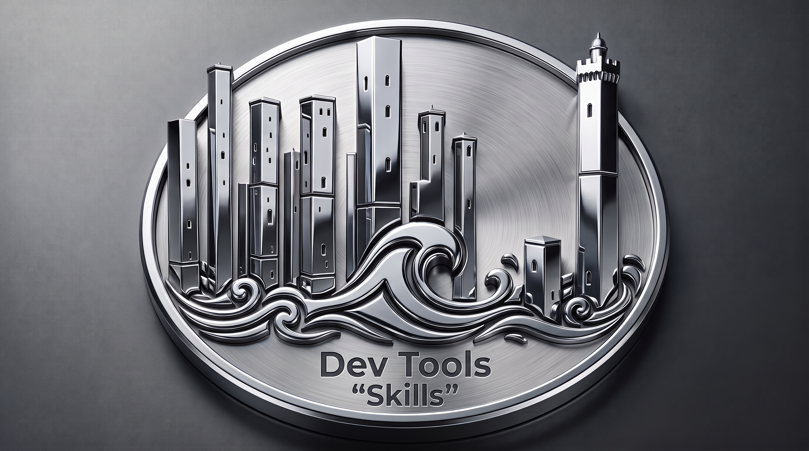

<h1>
  
  
</h1>

This project is a Cursor Agent Skill. When a prompt includes `creates a new docker container named x`, the agent creates that container: `x` is the name in the prompt. It asks for the workload, network exposure, outbound access, storage, and configuration keys before it writes anything. It then pins the newest patched base image by digest and applies current container hardening practice.

You can also invoke it with `/create-docker-container`.

## What you get

The agent writes `containers/<name>/` with a Dockerfile, a Compose file, an ignore file, and a how-to FAQ. The running container is checked before the agent says it is done.

The container is set up to:

- run as a non-root user
- keep a read-only root filesystem
- drop every Linux capability and block new privileges
- avoid privileged mode, host namespaces, and the Docker socket
- set memory, CPU, process, and file limits
- publish ports on `127.0.0.1` only, on port 1024 or higher
- restart only on failure, with log rotation and a real healthcheck

The agent looks up the current Docker Engine stable release and the current CIS Docker Benchmark each time. The snapshot in the skill is not a substitute for that lookup. Host and daemon settings on your machine are not changed by the skill; each container’s how-to FAQ includes a checklist for operators.

## Security specifications

The skill enforces the following. Most Dockerfile and Compose rules are checked by `scripts/validate-container.sh` (validator ids are in [security-baseline.md](.cursor/skills/create-docker-container/references/security-baseline.md)). Image scanning and host hardening are documented in the FAQ and reference files linked below.

### Image build and supply chain

Security starts at the image build stage: bloated images, hardcoded secrets, and untrusted bases are common incident sources.

- **Minimal or distroless base images** — Prefer slim, Alpine, distroless, or Docker Hardened Images over full OS images for the **final** stage. Full distributions belong in builder stages only. The validator checks `minimal-runtime` and `no-dev-tooling-final`.
- **Pin base image digests** — Every `FROM` (except `scratch`) uses `repository@sha256:…`, with the human tag in a comment above the line. No `:latest`. Checks: `from-digest`, `from-tag-comment`, `from-no-latest`.
- **Multi-stage builds** — Compile and bundle in a builder stage; copy only runtime artifacts into a clean final stage. Check: `multistage-when-compile` when npm, cargo, go, make, mvn, gradle, or similar appear in the Dockerfile.
- **Never hardcode secrets in images** — No secrets in `ENV`, `ARG`, or `COPY` of `.env`, keys, or PEM files. Build-time secrets use BuildKit `RUN --mount=type=secret`; runtime secrets use a gitignored `.env` or an external manager. Checks: `no-secret-env`, `no-copy-secrets`.
- **Run as a non-root user** — Dedicated `USER` in the Dockerfile and the same identity in Compose (`user-nonroot`).
- **Scan images continuously** — After build, run `bash .cursor/skills/create-docker-container/scripts/scan-image.sh <image:tag>` (Trivy, then Grype, then Docker Scout). Fail on critical and high findings when a scanner is present. For CI, use [ci-container-scan.yml](.cursor/skills/create-docker-container/assets/ci-container-scan.yml). Details: [supply-chain-security.md](.cursor/skills/create-docker-container/references/supply-chain-security.md).

### Container runtime hardening

When the container starts, restrictions limit the impact of a compromise. These are enforced in `compose.yml` and verified on a running container with the validator.

- **No privileged mode** — `privileged: true` and `--privileged` are forbidden (`no-privileged`). Add only required capabilities with `cap_add` when the baseline allows it; the skill keeps `cap_drop: ["ALL"]` and an empty `cap_add` by default.
- **Drop all capabilities** — `cap_drop: ["ALL"]`, then add back only what the app truly needs (`cap-drop-all`, `no-cap-add`). Unprivileged ports (1024+) avoid `NET_BIND_SERVICE`.
- **Prevent privilege escalation** — `security_opt: ["no-new-privileges:true"]` (`no-new-privileges`).
- **Read-only root filesystem** — `read_only: true` with explicit writable mounts and a bounded `tmpfs` on `/tmp` (`read-only`, `tmpfs-tmp`).
- **Never mount the Docker socket** — No `/var/run/docker.sock` in volumes (`no-docker-sock`).
- **Set resource limits** — Memory, CPU, process count, and open-file limits (`memory-limit`, `cpu-limit`, `pids-limit`, `nofile-limit`).
- **Default seccomp and MAC** — Do not disable profiles in Compose (`no-unconfined`). Rely on the host’s AppArmor or SELinux and default seccomp.

Also enforced: no host network/PID/IPC/UTS, no sensitive host bind mounts, no shared mount propagation, localhost-first port publish, user-defined bridge network, real healthcheck, log rotation, and `init: true`. See the runtime table in [security-baseline.md](.cursor/skills/create-docker-container/references/security-baseline.md).

### Host and Docker daemon configuration

The skill does **not** edit the host or `daemon.json`. Each project’s `HOWTO.md` copies a checklist from [host-daemon-security.md](.cursor/skills/create-docker-container/references/host-daemon-security.md). Operators should:

- **Protect the Docker socket** — Limit membership in the `docker` group; never expose unauthenticated TCP on port 2375; use TLS on 2376 for remote API access.
- **Enable user namespace remapping** — Set `userns-remap` in `/etc/docker/daemon.json` when policy allows, or run rootless Docker.
- **Configure logging and auditing** — Daemon log rotation (`max-size`, `max-file`); audit critical paths such as `/etc/docker` and `/var/lib/docker`; forward container logs when production policy requires it.
- **Keep Engine and runc updated** — Require Engine **≥ 29.9.1** and containerd **≥ 2.4.2** before creating containers; patch promptly for container escape fixes. Upgrade steps: [engine-upgrade.md](.cursor/skills/create-docker-container/references/engine-upgrade.md).

## Requirements

Docker Engine with Compose v2 and BuildKit, on the machine where the container is created. The agent stops if Docker is missing.

**Security floor:** Engine **≥ 29.9.1** and bundled containerd **≥ 2.4.2** (checked with `check-docker-versions.sh`). Older versions trigger a warning and the agent asks whether to upgrade the host, continue at your own risk, or stop.

```bash
bash .cursor/skills/create-docker-container/scripts/check-docker-versions.sh
```

Secret values stay in a gitignored `.env`. The chat is asked for key names only.

<h2></h2>

The validator tests do not need a running Docker daemon:

```bash
bash .cursor/skills/create-docker-container/scripts/test-validator.sh
```

Validate a container project (static files only):

```bash
bash .cursor/skills/create-docker-container/scripts/validate-container.sh \
  --project containers/<name> --static-only
```

Full skill entry point: [SKILL.md](.cursor/skills/create-docker-container/SKILL.md).
